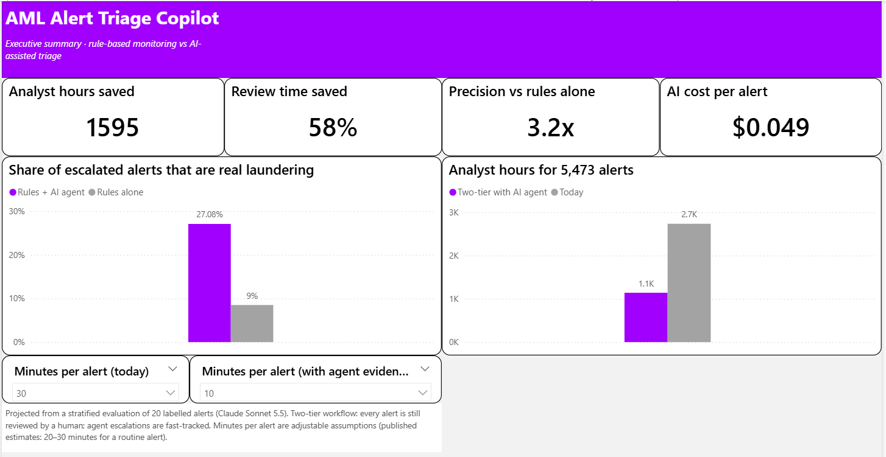
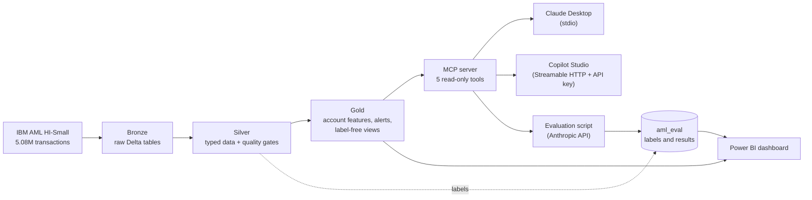
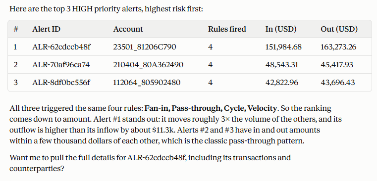

# AML Agent Copilot

An AI copilot that triages anti-money-laundering (AML) alerts: it investigates each alert in bank transaction data, names the likely laundering pattern, and recommends **escalate** or **close**, with evidence.

Built end to end on **Databricks**, a custom **MCP server**, **Claude**, and **Power BI**, and evaluated against ground-truth labels.

## The problem

Rule-based transaction monitoring floods compliance teams with alerts, and **90–95% of them are false positives**. Analysts spend most of their time gathering evidence for alerts that turn out to be nothing.

## Results

| | Rules alone | Rules + AI agent |
|---|---|---|
| Share of escalated alerts that are real laundering | 8.5% | **27%** (projected, 3.2x) |
| False alerts correctly closed | – | **90%** |
| Analyst hours for 5,473 alerts* | 2,736 h | **1,141 h (58% saved)** |
| Cost per alert | analyst time only | **$0.05 and 25 seconds** |

\*Two-tier workflow: every alert is still reviewed by a human, but the agent pre-gathers evidence and fast-tracks its escalations. Assumes 30 minutes per alert without the agent and 10 minutes with its evidence (adjustable in the dashboard).

Agent results come from a stratified evaluation of 20 labelled alerts (10 laundering, 10 false positives) with Claude Sonnet 5.5, projected to the full queue using the real 8.5% base rate.



## Architecture



## How it works

**1. Data pipeline (Databricks, PySpark, Delta Lake, Unity Catalog)**
A medallion pipeline over the IBM AML synthetic dataset: 5,078,345 transactions, 518,581 accounts, 166,207 entities, 0.10% laundering. Silver tables pass automated quality gates (row reconciliation, unique keys, referential integrity), and amounts are converted from 15 currencies to USD using rates derived from the data itself.

**2. Detection rules**
Five label-free network rules (fan-out, fan-in, pass-through, 2–3 hop cycles, velocity), with thresholds at the 99th percentile. Accounts that fire two or more rules become alerts: **5,473 alerts, 6.9x lift over random selection**.

**3. AI agent and MCP server**
A Python MCP server exposes five read-only tools over the Gold layer: `list_alerts`, `get_alert`, `get_account_transactions`, `get_counterparties`, `get_rules`. The agent follows a written triage procedure ([`agent/triage_prompt.md`](agent/triage_prompt.md)) and returns structured JSON: decision, pattern, confidence, risk score, evidence, the most likely innocent explanation, and a next step.



**4. Evaluation**
An automated script runs the agent on the sample through the Anthropic API and logs every decision, its tokens and its cost. Notebooks score the decisions against labels kept in a separate schema.

**5. Dashboard (Power BI)**
Three pages: an executive summary with adjustable assumptions, the alert queue with the agent's decisions, and detection insight (recall by scheme, precision by rule, agent vs truth).

## Key design decisions

- **No label leakage.** The rules and the agent only read `aml_gold`, which a schema-wide check proves is label-free. Labels live in `aml_eval`, which in production would not be granted to the agent's identity.
- **Quality gates at every layer.** Each notebook stops before writing if counts, keys or joins don't reconcile.
- **Deterministic IDs.** Transaction and alert IDs are hashes, so reruns produce the same IDs and audit links stay valid.
- **Fixed, parameterised tools.** The agent can't run arbitrary SQL. Its inputs are treated as untrusted, and results are capped to protect the context window.
- **A frozen prompt.** The triage prompt was fixed before the evaluation run, so the results aren't tuned to the test sample.
- **One server, two AI platforms.** The same MCP tools serve Claude Desktop locally and Copilot Studio over HTTPS with API-key authentication.

## Limitations and next steps

- **Recall is limited.** The agent escalated 4 of 10 real cases. It misses distributed schemes (Stack, Bipartite) because its tools show only one hop around an account. This is why the recommended design keeps a human review for every alert it closes. **Next:** a multi-hop network tool.
- **A small evaluation sample.** With 20 alerts, results are an early signal, not a final metric. **Next:** a larger sample with a separate development set for prompt tuning.
- **Rules miss distributed laundering too:** they catch 77% of gather-scatter but only 16% of bipartite transactions.
- **Copilot Studio:** the agent was configured and the server tested over a public HTTPS tunnel, but deployment was blocked by an expired trial licence on a university account.
- **Time per alert is an assumption,** based on published industry estimates (20–30 minutes for a routine alert).

## Repository structure

```
notebooks/      01–07  Bronze → Silver → Gold pipeline, alerts and agent views
evaluation/     01 rule baseline · 02 agent sample · 03 agent scoring
                run_agent_eval.py, sample_alert_ids.txt, results/
agent/          triage_prompt.md (the agent's procedure)
mcp_server/     server.py (stdio) · http_server.py (Streamable HTTP + API key)
dashboard/      01_powerbi_tables · aml_copilot_dashboard.pbix · aml_theme.json
docs/           business_case.md · img/
```

## How to run

**Databricks (Free Edition works)**
1. Download the IBM AML dataset (HI-Small) and upload `HI-Small_Trans.csv`, `HI-Small_accounts.csv` and `HI-Small_Patterns.txt` to the volume `workspace.aml_bronze.raw_files`.
2. Run `notebooks/01` to `07`, then `evaluation/01` and `02`, then `dashboard/01_powerbi_tables`.

**MCP server**
```powershell
cd mcp_server
python -m venv .venv
.venv\Scripts\activate
pip install -r requirements.txt
```
Create `mcp_server/.env`:
```
DATABRICKS_SERVER_HOSTNAME=...
DATABRICKS_HTTP_PATH=...
DATABRICKS_TOKEN=...
ANTHROPIC_API_KEY=...
MCP_API_KEY=...
```
- **Claude Desktop:** add `mcp_server/.venv/Scripts/python.exe` with `server.py` as an MCP server in `claude_desktop_config.json`.
- **HTTP (for Copilot Studio):** run `python http_server.py`, expose port 8000 with a tunnel, and connect it as an MCP tool with an `x-api-key` header.
- **Evaluation:** `python evaluation/run_agent_eval.py` (resumable; `--limit 2` for a cost test).

## Tech stack

Databricks · PySpark · Delta Lake · Unity Catalog · SQL · Python · Model Context Protocol · Claude (Anthropic API) · Copilot Studio · Power BI · DAX · Git

## Data

[IBM Transactions for Anti-Money Laundering](https://www.kaggle.com/datasets/ealtman2019/ibm-transactions-for-anti-money-laundering-aml), a synthetic dataset described in Altman et al., [*Realistic Synthetic Financial Transactions for Anti-Money Laundering Models*](https://arxiv.org/abs/2306.16424). No real customer data is used.

## Author

Mohammed Khaled · [LinkedIn](https://www.linkedin.com/in/mohammed-khaled-43a220183) · [Portfolio](https://mdkhaledportfolio.netlify.app)
